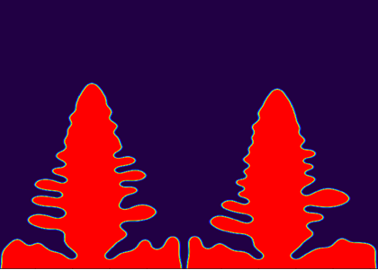
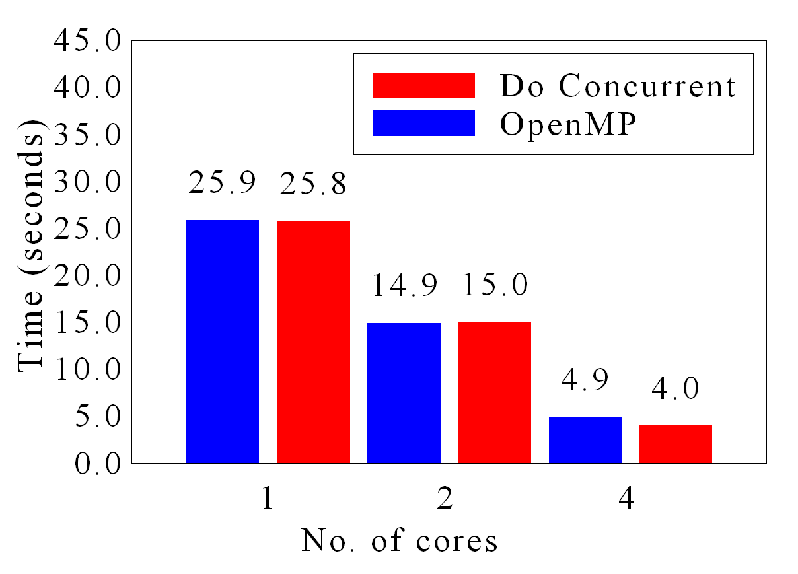
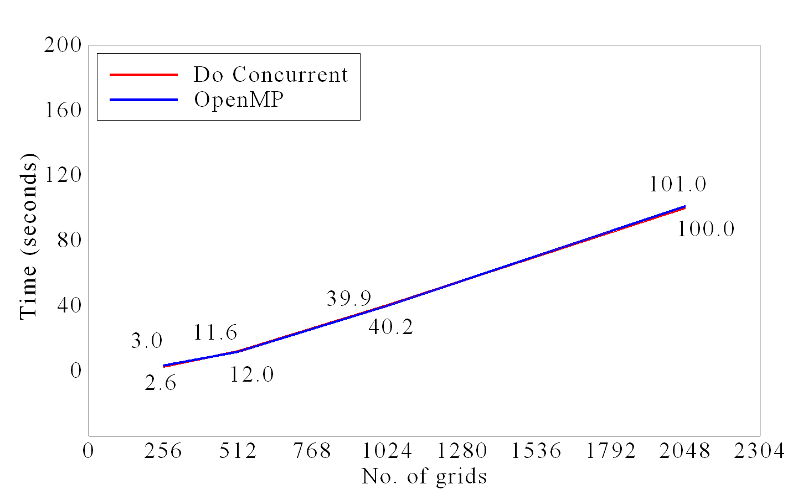

# **AMSimulator**

<div style="text-align: center;">



</div>

**A Fortran phase-field solver for dendritic solidification, used as a benchmark to compare `do concurrent` against OpenMP for shared-memory parallelism.**

This repository accompanies the study:

> Maqbool, S. and Lee, B.-J. (2025). *High Performance Additive Manufacturing Phase Field Simulation: Fortran Do Concurrent vs OpenMP.* Computational Materials Science, 252, 113788.
> [https://www.sciencedirect.com/science/article/pii/S0927025625001314](https://www.sciencedirect.com/science/article/pii/S0927025625001314)

If you use this code in your own work, please cite the paper above.

---

The paper implemented the **Kim et al. [model](https://www.jstage.jst.go.jp/article/isijinternational1989/39/4/39_4_335/_pdf)**. This repository has the formulation with the **standard (Kobayashi-type) phase-field model of dendritic solidification of a pure substance**, which is a widely used in the phase-field community. The two formulations share the same overall numerical structure — a coupled phase-field / temperature evolution solved on a uniform 2D grid with finite differences — but differ in how the physical driving-force and anisotropy parameters are derived. This makes the code easier to validate independently and to compare against other open implementations of the same model.

The **parallelization comparison (OpenMP vs `do concurrent`) is unaffected** by this change: both strategies are applied to the same gradient computation and field-update loops described below.

---

## Governing model

The solver implements the anisotropic, Kobayashi-type phase-field model of dendritic solidification of a **pure substance** (parameterized here for pure nickel). It couples an order-parameter (phase) field $\phi(\mathbf{x},t)$ to the temperature field $T(\mathbf{x},t)$ on a two-dimensional domain with periodic boundary conditions.

$\phi = 1$ denotes solid, $\phi = 0$ denotes liquid, and the solid–liquid interface is represented as a diffuse layer of finite width $\delta$.

### Interfacial anisotropy

The gradient-energy coefficient is anisotropic, varying with the local interface normal angle $\theta$:

```math
\theta = \arctan2\!\left(\frac{\partial \phi}{\partial y},\ \frac{\partial \phi}{\partial x}\right)
```

```math
a(\theta) = a_0\Big[\,1 + \alpha \cos\big(k(\theta-\theta_0)\big)\Big], \qquad
a'(\theta) = -a_0\, k\, \alpha \sin\big(k(\theta-\theta_0)\big)
```

where $k$ is the fold number of the interfacial anisotropy (four-fold here) and $\alpha$ is the anisotropy strength.

### Phase-field evolution

```math
\frac{\partial \phi}{\partial t} = M\left[\, a(\theta)^2 \nabla^2 \phi
\;+\; \frac{\partial}{\partial y}\!\Big(a(\theta)\,a'(\theta)\,\frac{\partial \phi}{\partial x}\Big)
\;-\; \frac{\partial}{\partial x}\!\Big(a(\theta)\,a'(\theta)\,\frac{\partial \phi}{\partial y}\Big)
\;+\; 4W\,\phi(1-\phi)\Big(\phi-\tfrac12+\tfrac{15}{2W}\,f(T)\,\phi(1-\phi)\Big)\right]
```

with interface mobility $M$, double-well barrier height $W$, and thermodynamic driving force

```math
f(T) = -\,\frac{H\,(T - T_m)}{T_m},
```

i.e. proportional to the local undercooling below the equilibrium melting point $T_m$, scaled by the latent heat of fusion $H$.

### Temperature evolution

```math
\frac{\partial T}{\partial t} = \frac{T_k}{C_p}\nabla^2 T
\;+\; 30\,\phi^2(1-\phi)^2\,\frac{H}{C_p}\,\frac{\partial \phi}{\partial t}
```

where $T_k$ is the thermal conductivity, $C_p$ the specific heat capacity, and $30\phi^2(1-\phi)^2$ is the derivative of the smooth interpolation polynomial $p(\phi) = \phi^3(10-15\phi+6\phi^2)$, which confines latent-heat release to the diffuse interface region.

A stochastic perturbation is added to $\phi$ at each time step to seed dendritic side-branching, following the standard practice for this class of model.

### Model constants

$a_0$, $W$, and $M$ are not independent inputs — they are derived from the interfacial energy $\sigma$, interface width $\delta$, interface-kinetics coefficient $\mu$, and the thin-interface coupling constant $\lambda$ (following the thin-interface asymptotics of Karma & Rappel):

```math
b = 2\,\tanh^{-1}(1-2\lambda), \qquad
a_0 = \sqrt{\frac{3\delta\sigma}{b}}, \qquad
W = \frac{6\sigma b}{\delta}, \qquad
M = \frac{b\,T_m\,\mu}{3\delta H}
```

The discrete implementation (finite-difference Laplacian and centered gradients on a uniform grid, explicit Euler time-stepping) follows the reference serial code in [`legacyToModernFortran/Fortran90/main90.f90`](./legacyToModernFortran/Fortran90/main90.f90). The modular version in `src/` implements the same equations across the modules listed above, parallelized with OpenMP or `do concurrent`.

### Parameters (pure nickel)

| Symbol | Meaning | Value |
|---|---|---|
| `dx`, `dy` | grid spacing | `20 × 10⁻⁹ m` |
| `δ` | interface width | `4·dx` |
| `σ` | interfacial energy | `0.37 J/m²` |
| `α` | anisotropy strength | `0.05` |
| `aniso` | anisotropy mode number (four-fold) | `4` |
| `θ₀` | preferred growth-direction offset | `0` |
| `Tm` | melting temperature | `1728 K` |
| `Tk` | thermal conductivity | `84.01 W/(m·K)` |
| `Cp` | specific heat capacity | `5.42 × 10⁶ J/(m³·K)` |
| `H` | latent heat of fusion | `2.35 × 10⁹ J/m³` |
| `μ` | interface kinetic coefficient | `2.0` |
| `λ` | thin-interface coupling constant | `0.1` |
| `b` | derived from `λ`: `b = 2·atanh(1 − 2λ)` | — |
| `a₀` | gradient-energy coefficient: `a₀ = √(3δσ/b)` | — |
| `W` | double-well height: `W = 6σb/δ` | — |
| `M` | interface mobility: `M = bTmμ / (3δH)` | — |
| `Δt` | time step: `dx² / (5·Tk/Cp)` | — |
| `T₀` | initial undercooled melt temperature: `Tm − 0.3H/Cp` | — |

These match the reference serial code exactly; change them in `InputManagerModule.f90` (or `app/main.f90`) to simulate a different material or interface-kinetics regime.

---

## Simulator structure

```
Simulator
├── CMakeLists.txt   # Build configuration (choice of OPENMP or DO_CONCURRENT backend)
├── app/             # Main program (entry point: main.f90)
├── src/             # Core solver modules (see below)
├── script/          # Helper scripts (post-processing)
```

### `src/` modules

| File | Purpose |
|---|---|
| `PrecisionRangeModule.f90` | Kind parameters (single/double precision) |
| `InputManagerModule.f90` | Simulation parameters and input handling |
| `ErrorModule.f90` | Error/status reporting |
| `TimeStampModule.f90` | Run timing and timestamps |
| `InitialMicrostructureModule.f90` | Generation of the initial seed/profile |
| `AnisotropySolverModule.f90` | Interface-angle-dependent anisotropy coefficients and gradients |
| `DrivingForceModule.f90` | Undercooling-driven phase-field forcing term |
| `StencilModule.f90` | Finite-difference stencils (Laplacian, etc.) |
| `UpdateFieldModule.f90` | Field swap/update between time steps |
| `NoiseModule.f90` | Random side-branching perturbations |
| `OutputManagerModule.f90` | Field output and result export |
| `ArrayManagerModule.f90` | Array allocation/deallocation |

---

## Parallelization strategies

The performance-critical loops (gradient computation, phase-field update, temperature update) are implemented **twice**, guarded by a preprocessor flag, so that the two approaches can be benchmarked on identical numerics:

- **OpenMP** — `!$omp parallel do collapse(2)` directives with explicit `private`/`shared` clauses.
- **`do concurrent`** — standard Fortran (2008/2018) parallel loops with `local`/`shared` locality specifications, requiring no external threading API.

Build selection is controlled by the CMake option `PARALLELIZATION`.

---

## Dependencies

- A Fortran compiler supporting Fortran 2008/2018 `do concurrent` locality specifiers and OpenMP:
  - [NVIDIA HPC SDK (`nvfortran`)](https://developer.nvidia.com/hpc-sdk) — required for CPU-multicore-parallel `do concurrent` via `-stdpar=multicore`
- [CMake ≥ 3.12](https://cmake.org/)
- Linux (the build is configured for Linux only; see `CMakeLists.txt`)

---

## Building

```bash
mkdir build && cd build

# OpenMP build
cmake -DPARALLELIZATION=OPENMP -DCMAKE_Fortran_COMPILER=nvfortran ..
make

# do concurrent build
cmake -DPARALLELIZATION=DO_CONCURRENT -DCMAKE_Fortran_COMPILER=nvfortran ..
make
```

The executable is placed in `build/output/main`.

> **Note (NVIDIA HPC SDK):** for the `DO_CONCURRENT` build to actually run multithreaded, the compiler must be given a `stdpar` flag (e.g. `-stdpar=multicore` for CPU threads. Without it, `nvfortran` compiles `do concurrent` loops as single-threaded (SIMD-vectorized) code, which will make the `do concurrent` build appear artificially slower than the OpenMP build in any timing comparison.

---

## Running

```bash
cd build/output
./main
```

Simulation parameters (grid size, number of iterations, physical constants) are set in `app/main.f90` and the relevant `src/` modules — adjust these before building for different domain sizes or run lengths.

Timing output (wall-clock seconds for the time-stepping loop) and compiler/build metadata are printed to the console at the end of the run, useful for the OpenMP vs `do concurrent` scaling comparison described in the paper.

---


# **directory structure**

The structure of the repository is
```
AMSimulator
├── languages
├── legacyToModernFortran
├── plotting
└── simulator
```

## languages
This folder shows the code in the selected languages.
```
languages
├── Fortran
├── C
├── C++
├── matlab
└── python
```

## legacyToModernFortran
This folder shows the use of the Fortran standards to write the code in serial and parallel.

```
legacyToModernFortran
├── FORTRAN77
├── Fortran90
├── Fortran2008
└── OpenMP
```

## simulator
The folder contains the simulator. 

## plotting

The plotting directory shows the use of dislin graphical library to plot bar charts and line graphs. The example looks like





---

## Citation

```bibtex
@article{maqbool2025amsimulator,
  title   = {High Performance Additive Manufacturing Phase Field Simulation: Fortran Do Concurrent vs OpenMP},
  author  = {Maqbool, S. and Lee, B.-J.},
  journal = {Computational Materials Science},
  volume  = {252},
  pages   = {113788},
  year    = {2025},
  doi     = {10.1016/j.commatsci.2025.113788}
}
```
## **Note:**

The Fortran codes are tested with the intel compiler (ifort) on Windows 10. The simulator app is tested with nvfortran on Ubuntu 24.04.4 with NVHPC 24.11.0

## **Date**
 February 25, 2025
